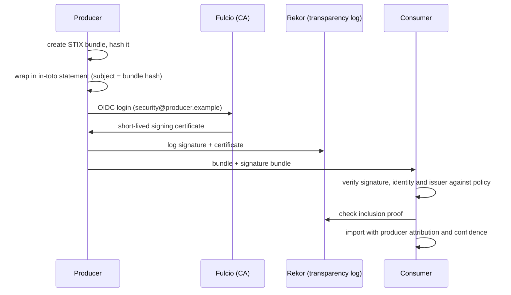

# Signed Provenance for Indicators

Make every TI claim a **signed statement** that can be verified anywhere.

## Options

| Mechanism | Fit |
|---|---|
| Sigstore (keyless signing with OIDC identity, transparency log) | strong identity binding for organisations; public log |
| in-toto attestations | generic attestation envelope (DSSE) for any statement |
| W3C Verifiable Credentials | identity-centric claims; selective disclosure options |
| PGP signatures | traditional, weak identity UX |
| On-chain attestations (e.g. Ethereum Attestation Service) | public, timestamped, composable with smart contracts |

These are not mutually exclusive. A common pattern is an in-toto statement (the *what*) inside a DSSE envelope (the *wrapper*), signed with Sigstore (the *who*), with the signature recorded in Rekor (the *when*, tamper-evident). The same tools secure software supply chains; the **Web3 Supply Chain Security** and **ML Model Supply Chain Security** books use them for packages and model weights.

## A practical design



The transparency log provides tamper-evident history: a producer cannot silently rewrite what it claimed.

One consequence deserves a decision before you start: public transparency logs are public. Logging a signature reveals that a producer signed *something* with a given hash at a given time, and the certificate reveals the signer identity. For TLP:RED or sensitive material, use a private Sigstore deployment or sign with managed keys without public logging, and keep the public log for material you would share openly anyway.

## Retractions

Retractions are signed statements referencing the original claim. Consumers must process them. Make retraction checking part of the import pipeline.

A minimal retraction statement needs: the hash or STIX ID of the original claim, a reason code (false positive, expired, superseded, producer compromise), a timestamp, and the same signing identity (or a documented successor). Consumers should treat a retraction from a *different* identity as a dispute, not a retraction.

## Key and identity management

Signed provenance is only as strong as the producer's identity hygiene. Keyless signing ties signatures to OIDC identities, so protect the identity provider account with phishing-resistant MFA. Long-lived keys need rotation and revocation plans. Consumers should pin identities (e.g. a specific email or workload identity) rather than accepting any valid signature, and should alert when a trusted producer's identity changes. Treat a producer compromise like a supply chain compromise: revoke trust, review recent claims, and process retractions.

For automated feeds, prefer a **workload identity** (for example a CI job's OIDC token) over a person's mailbox. Then the policy can pin both the repository and the workflow that produces the feed, and nobody's personal account becomes a single point of failure.

## Worked example

_Not executed in this book's CI; verify locally. Outputs shown are expected results, not captured runs._

Goal: sign the STIX bundle from Chapter 2 with cosign keyless signing, verify it with an identity policy, and find it in Rekor. Requires cosign v2 or later and a browser for the OIDC login.

1. Sign, producing a single Sigstore bundle file with signature, certificate and log entry.

```bash
cosign sign-blob bundle.json --bundle bundle.sigstore.json --yes
# opens a browser for OIDC login; the identity becomes part of the certificate
```

2. Verify with a pinned identity and issuer. Replace with your own values.

```bash
cosign verify-blob bundle.json --bundle bundle.sigstore.json \
  --certificate-identity security@producer.example \
  --certificate-oidc-issuer https://accounts.google.com
# expected: "Verified OK"
```

3. Show that the policy matters: verify with a different identity and confirm it fails.

```bash
cosign verify-blob bundle.json --bundle bundle.sigstore.json \
  --certificate-identity attacker@example.com \
  --certificate-oidc-issuer https://accounts.google.com
# expected: an error about the certificate identity not matching
```

4. Tamper with the content (change one character in `bundle.json`) and verify again. Expected: signature verification fails.

5. Find the entry in the public log by content hash.

```bash
rekor-cli search --sha "$(sha256sum bundle.json | cut -d' ' -f1)"
```

Expected output: one or more Rekor entry UUIDs. `rekor-cli get --uuid <uuid>` shows the logged certificate and integrated time.

6. Write the import policy as code: a list of trusted producers, each with identity, issuer, and the maximum confidence the importer will accept from them.

## Common pitfalls

- Verifying that a signature is valid without checking *who* signed it. Any Sigstore user can produce a valid signature.
- Publishing sensitive material's signatures to a public transparency log.
- Signing with a personal identity for an automated feed, then losing the feed when that person leaves.
- Accepting retractions from any identity, which lets an attacker silence real indicators.
- No plan for producer compromise: which claims to distrust, from when.

## Exercises

1. Sign a STIX bundle with cosign (blob signing) and verify it with an identity policy.
2. Write a retraction statement format and implement processing in a small importer.
3. Search Rekor for your signed entry.
4. Repeat signing from a CI workflow and pin the workflow identity in your policy.

## Further reading

- Sigstore: <https://www.sigstore.dev>, cosign: <https://github.com/sigstore/cosign>
- Rekor: <https://github.com/sigstore/rekor>
- in-toto attestations: <https://github.com/in-toto/attestation>
- DSSE: <https://github.com/secure-systems-lab/dsse>
- W3C Verifiable Credentials Data Model: <https://www.w3.org/TR/vc-data-model-2.0/>
- Ethereum Attestation Service: <https://attest.org>
