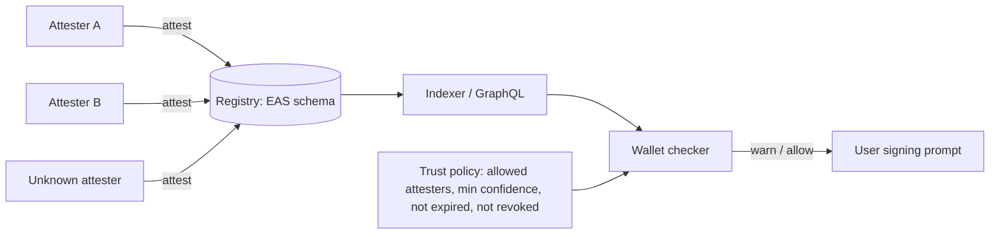

# On-Chain Threat Registries

For Web3 threats, on-chain registries let wallets and contracts consume threat data directly.

## Designs

- **Attestation-based:** producers issue attestations ("address X is a drainer receiver, confidence 0.9, campaign Y") using schemas on EAS or similar. Consumers query attestations by trusted attesters.
- **Curated registries:** token-curated or committee-curated lists with challenge mechanisms.
- **Detection networks:** Forta-style bots emitting alerts that can be aggregated into labels.

The Ethereum Attestation Service (EAS) is a good reference design. A schema is registered once (a typed field list such as `address target, uint256 chainId, uint8 category, uint8 confidence, string reference`). Anyone can then attest against that schema; each attestation records the attester, the recipient, a timestamp, an optional expiry, and whether it is revocable. Attestations can be made on-chain (stored in contract state) or off-chain (signed EIP-712 data that can be published anywhere and verified against the same schema). Indexers expose them through GraphQL.

## Benefits

- Public, timestamped, composable (a contract can check a registry before transferring).
- No single list owner.
- Built-in expiry and revocation fields that map naturally onto STIX `valid_until` and retractions.

## Risks

| Risk | Note |
|---|---|
| Poisoning by malicious attesters | consumers must choose attesters, not accept all |
| Griefing legitimate addresses | false labels harm users; need dispute processes |
| Privacy | publishing victim addresses or internal details is permanent |
| Cost and latency | on-chain writes cost gas; urgent alerts may need off-chain channels first |
| Permanence | wrong claims remain in history even when revoked |

Revocation in an attestation registry marks the attestation revoked; it does not erase it. Anyone reading history will still see that the claim was made. That is useful for accountability and harmful for a legitimate address that was wrongly labelled. Prefer off-chain attestations for claims about addresses that might belong to victims or uninvolved parties, and reserve on-chain attestations for claims you are prepared to stand behind permanently.

## Consumption patterns

- **Wallets:** query trusted attesters off-chain via indexers before signing.
- **Contracts:** usually avoid synchronous checks (cost, censorship concerns); use for opt-in features like "safe receive".



The policy box is where security lives. The registry accepts anyone's attestations by design; the consumer decides whose count.

## Worked example

_Not executed in this book's CI; verify locally. Outputs shown are expected results, not captured runs._

Goal: a wallet-side checker that asks an EAS indexer whether a recipient address has been flagged by attesters you trust. Use testnet attestations you created yourself (Exercise 1) or any public schema on a testnet. Endpoint names and GraphQL fields follow the EAS documentation at the time of writing; check the docs for your network.

1. Define the policy.

```python
TRUSTED = {"0x00000000000000000000000000000000000000a1": 1.0,   # your own attester
           "0x00000000000000000000000000000000000000a2": 0.7}   # partner attester, discounted
SCHEMA = "0x<schema-uid>"
ENDPOINT = "https://sepolia.easscan.org/graphql"
```

2. Query attestations for the recipient by trusted attesters, excluding revoked ones.

```python
import requests, time
Q = """query($schema:String!,$recipient:String!,$attesters:[String!]){
  attestations(where:{schemaId:{equals:$schema}, recipient:{equals:$recipient},
                      attester:{in:$attesters}, revoked:{equals:false}}){
    id attester time expirationTime decodedDataJson } }"""
def check(recipient):
    r = requests.post(ENDPOINT, json={"query": Q, "variables": {
        "schema": SCHEMA, "recipient": recipient, "attesters": list(TRUSTED)}}).json()
    now, score = time.time(), 0.0
    for a in r["data"]["attestations"]:
        if a["expirationTime"] and int(a["expirationTime"]) < now:
            continue
        score = max(score, TRUSTED[a["attester"]])
    return score
print(check("0x00000000000000000000000000000000000000b0"))
```

3. Map the score to wallet behaviour: `>= 0.9` show a blocking warning, `>= 0.5` show a caution, otherwise nothing.

Expected output: `0.0` for an address nobody trusted flagged, `1.0` or `0.7` for one you attested. Create an attestation from an *untrusted* account for the same address and confirm the score does not change. That last test is the one that proves the policy, not the registry, decides.

4. Cache results with a short time-to-live and fail open with a visible "threat data unavailable" notice, rather than blocking all transactions when the indexer is down.

## Common pitfalls

- Querying all attestations for a schema without filtering by attester, which hands control to anyone with gas.
- Ignoring `expirationTime` and `revoked`, so stale claims block forever.
- Putting victim addresses or internal case references on-chain, permanently.
- Making a contract's transfer path depend synchronously on a registry that an attacker or a bug can fill.
- No dispute process, so a wrongly labelled project has no route to correction.

## Exercises

1. Define an EAS schema for scam address claims and create test attestations on a testnet.
2. Build a wallet-side checker querying attestations from a configurable set of attesters.
3. Write the dispute process for a false label.
4. Compare on-chain and off-chain attestations for the same claim: cost, privacy, and how a consumer verifies each.

## Further reading

- Ethereum Attestation Service docs: <https://docs.attest.org>
- EIP-712 (used by off-chain attestations): <https://eips.ethereum.org/EIPS/eip-712>
- Forta: <https://docs.forta.network>
- Chainabuse: <https://www.chainabuse.com>
