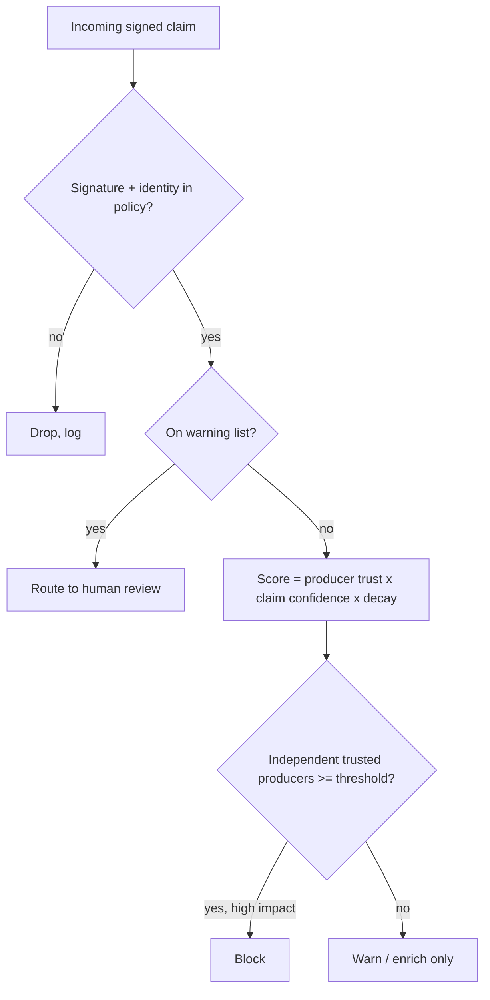

# Poisoning Resistance and Trust Scoring

Open, multi-producer sharing invites manipulation. This chapter turns the provenance from Chapter 3 and the validity fields from Chapter 2 into an importer that resists poisoning.

## Poisoning attacks

- **False positives:** adding legitimate infrastructure (CDNs, popular contracts) to blocklists to cause outages.
- **False negatives via retraction abuse:** compromised producer retracts real indicators.
- **Sybil producers:** many fake producers vouching for each other.
- **Stale data:** old indicators reassigned to new owners (IPs, domains).

In Web3 the false-positive attack has a specific flavour: labelling a popular router, bridge or token contract as malicious can cause wallets to block normal use, and labelling a competitor's contract can damage a project. Attackers also try the opposite: getting their own drainer receiver whitelisted by mixing it into a "verified contracts" submission.

## Defences

- **Warning lists:** never block known-benign infrastructure (MISP warning lists are a model).
- **Producer trust scores** based on historical accuracy (confirmed vs retracted vs disputed claims).
- **Corroboration thresholds:** high-impact actions (blocking) require multiple independent producers.
- **Decay:** confidence decreases over time without re-sightings.
- **Change auditing:** producer key or identity changes trigger review.



## Scoring that resists Sybils

Corroboration only helps if producers are *independent*. Ten new producers that appeared last week and agree on everything are one producer. Practical rules:

- Count corroboration only from producers above a trust threshold, which takes time and a track record to reach.
- Group producers by organisation or by shared infrastructure (same signing identity domain, same CI) and count each group once.
- Start new producers at low weight and raise weight only as their claims are confirmed.

A simple, explainable score is usually better than a clever one. For example: `score = trust(producer) × confidence(claim) × 0.5^(age / half_life)`, with corroboration counted separately. Publish the formula so producers know how they are judged.

## Measuring producer accuracy

Sample claims from each producer, verify (sandbox, chain analysis), and update scores. Publish methodology so scores are contestable.

AI can help with volume here, under the usual rule: the model proposes, the checker decides. A model can triage a sample of claims ("this domain's page content looks like a wallet phishing kit"), but a claim is only marked *confirmed* when a checker agrees: a crawler capture with a kit fingerprint match, an on-chain trace showing a drain, or a sandbox run. Model-only judgements count as "unverified" and do not move scores.

## Human review where it matters

Automation should handle volume, but high-impact actions deserve review. Blocking a widely used domain, contract or IP range can cause outages or freeze legitimate funds. Route such actions to an analyst with the full provenance chain: who claimed it, when, with what evidence, and who corroborated it. Record the decision so producer scores can be updated when the claim is later confirmed or refuted.

## Worked example

_The Python below was executed locally with Python 3 while writing this chapter and produced the output shown. It is not run in this book's CI._

Goal: an importer with decay, warning-list checks and corroboration, plus a Sybil test that it must pass.

```python
import time, math
HALF_LIFE = 30 * 86400
TRUST = {"prodA": 0.9, "prodB": 0.8, "prodC": 0.85}     # established producers
WARNING = {"0x000000000022d473030f116ddee9f6b43ac78ba3"}  # e.g. Permit2: never auto-block
def decayed(c, now): return c["confidence"] * 0.5 ** ((now - c["ts"]) / HALF_LIFE)

def decide(claims, now=None, min_trust=0.7, need=2):
    now = now or time.time()
    by_target = {}
    for c in claims:
        by_target.setdefault(c["target"].lower(), []).append(c)
    out = {}
    for t, cs in by_target.items():
        if t in WARNING:
            out[t] = "REVIEW"; continue
        trusted = {c["producer"] for c in cs if TRUST.get(c["producer"], 0) >= min_trust and decayed(c, now) >= 0.5}
        best = max((TRUST.get(c["producer"], 0.1) * decayed(c, now) for c in cs), default=0)
        out[t] = "BLOCK" if len(trusted) >= need else ("WARN" if best >= 0.4 else "IGNORE")
    return out

now = time.time()
claims = [
  {"producer": "prodA", "target": "0xAAA1", "confidence": 0.9, "ts": now - 86400},
  {"producer": "prodB", "target": "0xAAA1", "confidence": 0.8, "ts": now - 3600},
] + [  # Sybil test: 20 brand-new producers all flag a popular contract
  {"producer": f"sybil{i}", "target": "0x000000000022D473030F116dDEE9F6B43aC78BA3", "confidence": 1.0, "ts": now}
  for i in range(20)
] + [  # Sybil test 2: 20 new producers flag an ordinary address
  {"producer": f"sybil{i}", "target": "0xBBB2", "confidence": 1.0, "ts": now} for i in range(20)
]
print(decide(claims, now))
```

Observed output: `{'0xaaa1': 'BLOCK', '0x000000000022d473030f116ddee9f6b43ac78ba3': 'REVIEW', '0xbbb2': 'IGNORE'}`. That is, `0xaaa1` → `BLOCK` (two trusted, fresh claims), the Permit2 address → `REVIEW` (warning list), `0xbbb2` → `IGNORE` (twenty untrusted producers count for nothing; their discounted score of 0.1 stays below the warn threshold). Change `ts` on the `0xAAA1` claims to 120 days ago and check (not run here) the decision drops to `WARN` or `IGNORE` as decay takes effect.

Turn these cases into unit tests so any change to weights or thresholds that weakens Sybil resistance fails CI.

## Common pitfalls

- Counting producers instead of independent, trusted producers.
- No warning list, so a single bad claim blocks a core router or bridge.
- Decay applied to IP and domain indicators but not to address labels, which also go stale (contract upgrades, reused deposit addresses).
- Producer scores updated from model judgements alone.
- No record of human review decisions, so scores never learn from them.
- Secret scoring formulas that producers cannot contest.

## Exercises

1. Implement confidence decay and corroboration thresholds in an importer.
2. Simulate a Sybil poisoning attack and show corroboration from *trusted* producers prevents it.
3. Build a producer scorecard from a month of verified samples.
4. Add a retraction path to the importer and test that only the original identity can retract.

## Further reading

- MISP warning lists: <https://github.com/MISP/misp-warninglists>
- MISP decaying models documentation: <https://www.misp-project.org/documentation/>
- See **ai-red-teaming-security-copilots** Chapter 4 on knowledge poisoning.
